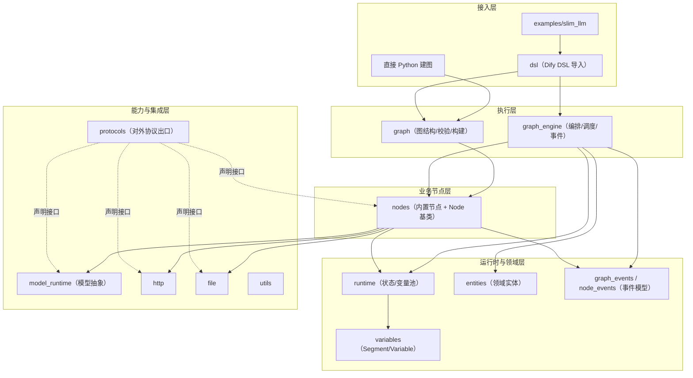
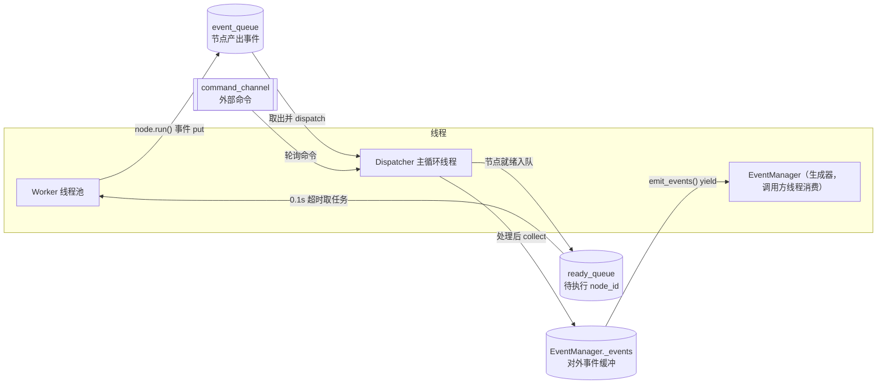

# Graphon 项目架构文档

> 类型：Python 图执行引擎（Graph execution engine for agentic AI workflows）
> 版本：0.4.0
> 适用读者：希望理解、扩展或与 Graphon 集成的开发者
> 源码根：`/home/jackson/graphon/src/graphon`

---

## 1. 项目概述

Graphon 是一个面向 agentic AI workflow 的**图执行引擎**。用户以「图」（节点 + 边）的方式描述工作流，引擎负责解析、校验、调度并事件驱动地执行这些节点，最终把结果从运行时状态中交付给调用方。

核心能力：

- 基于队列的 `GraphEngine` 编排与事件驱动执行
- 图的解析、校验与流式构建（fluent builder）
- 共享运行时状态、变量池与工作流领域模型
- 覆盖常见工作流模式的内置节点（LLM、分支、循环、迭代、HTTP、代码、变量操作、人工输入等）
- Dify DSL 导入支持，LLM 节点通过 Slim 适配器接入模型
- HTTP、文件、工具、人工输入等集成协议
- 可扩展的引擎层（Layer）与外部命令通道（Command Channel）

设计主线是**依赖倒置**：graphon 自身大量以 `Protocol` 定义抽象，具体基础设施（模型、HTTP 客户端、文件存储、代码沙箱、Redis 等）由宿主应用注入。

---

## 2. 技术栈与依赖

| 维度 | 选型 |
|---|---|
| 语言/运行时 | Python `>=3.12,<3.14`（3.14 因 `unstructured` 暂不支持） |
| 依赖与虚拟环境 | `uv`（`uv.lock` 锁定） |
| 数据建模 | Pydantic v2（`BaseModel`、`Discriminator`、`TypeAdapter`） |
| 类型检查 | `ty` |
| Lint/格式化 | `ruff`（`select = ['ALL']`，按规则忽略部分） |
| 测试 | `pytest`（`-n auto` 并行）、`pytest-xdist`、`pytest-cov`、`pytest-mock` |
| Git 钩子 | `prek` |
| 关键运行时依赖 | `httpx`、`jsonschema`、`orjson`、`pandas[excel]`、`pyyaml`、`tiktoken`、`transformers`、`unstructured`、`pydantic-extra-types` 等 |

构建后端为 `uv_build`。CI 校验 PR 标题（Conventional Commits）、`make check`、以及在 Python 3.12/3.13 双版本下运行 `uv run pytest`。

---

## 3. 整体架构

### 3.1 分层视图



### 3.2 一次执行的生命周期（宏观）

1. 构建或加载图：用 `GraphBuilder` 直接建图，或 `graphon.dsl.loads(dsl, credentials, ...)` 从 Dify DSL YAML 生成图。
2. 准备运行时：创建 `GraphRuntimeState`，用 `start_inputs` 播种 `VariablePool`。
3. 装配依赖：按需要注入模型（`LLMProtocol`）、HTTP 客户端、文件运行时、代码执行器等。
4. 运行引擎：`for event in engine.run(): ...` 消费事件流。
5. 读取结果：从 `GraphRuntimeState.outputs` 或终态事件（`GraphRunSucceededEvent`）获取最终输出。

---

## 4. 核心概念与数据模型

### 4.1 图结构（`graph/`）

- `Graph`（`graph/graph.py:44`）：持有 `nodes`、`edges`、`in_edges`、`out_edges`、`root_node`（`:47-51`）。
  - `Graph.init()`（`:299-375`）：Pydantic 配置校验 → 过滤 `custom-note` 画布节点 → 建节点/边索引 → 经 `NodeFactory` 实例化节点 → 将 `FAIL_BRANCH` 节点提升为 `BRANCH` → 标记非活动根分支为 `SKIPPED` → 运行图校验。
  - `GraphBuilder`（`:410-520`）：`new()` / `add_root()` / `add_node()` / `connect()` / `build()`，主要用于测试与程序化建图。
  - `NodeFactory`（Protocol，`:23-40`）：`create_node(node_config)`，解耦图结构与具体节点实现。
- `Edge`（`graph/edge.py:7-15`）：`id/tail/head/source_handle/state`；`source_handle` 支持条件分支选路。
- 校验体系（`graph/validation.py`）：`GraphValidator` + 可插拔 `GraphValidationRule`（默认校验边端点存在性、根节点类型）；失败抛 `GraphValidationError`。
- `GraphTemplate`（`graph/graph_template.py:6-28`）：子图模板，供 loop / iteration 等容器节点展开子图。

### 4.2 运行时状态与变量池（`runtime/`、`variables/`）

- **`GraphRuntimeState`**（`runtime/graph_runtime_state.py:593`）是可变运行时聚合器，由三个内部组件构成：
  - `_GraphRuntimeExecutionData`（`:269`）：`variable_pool`、`start_at`、`total_tokens`、`llm_usage`、`outputs`、`node_run_steps`，提供防御性副本访问。
  - `_GraphRuntimeSuspensionState`（`:343`）：paused/deferred 节点、图节点/边状态快照，支撑暂停恢复。
  - `_GraphRuntimeBindings`（`:430`）：ready_queue、graph_execution、response_coordinator、graph、child_engine_builder 的绑定。
  - 支持 `dumps/from_snapshot/loads`（`:768-820`，版本 `"1.0"`）完整状态持久化；协作者通过 `importlib` 懒加载 `graph_engine.*` 以解耦二者的依赖方向（`:849-886`）。
- **`VariablePool`**（`runtime/variable_pool.py:34`）是变量唯一真源，以 `variable_dictionary: defaultdict[str, dict[str, Variable]]` 按 `[node_id][variable_name]` 两级索引；保留 `sys`/`env`/`conversation`/`rag` 等系统节点 ID。核心方法：`from_bootstrap`、`add`、`get`（支持 File/Object 嵌套属性）、`convert_template`、`get_file`、`flatten` 等。
- **只读包装**（`graph_runtime_state_protocol.py`、`read_only_wrappers.py`）：`ReadOnlyGraphRuntimeState` / `ReadOnlyVariablePool` 均为 `typing.Protocol`，包装器返回 deepcopy / model_copy，防止 Layer 篡改运行时状态。
- **`Segment` / `Variable`**（`variables/`）：`Segment`（`variables/segments.py:13`，frozen）是不可变运行时值；`VariableBase = Segment + id/name/description/selector`；`Variable` 为判别联合（`variables/variables.py:167`）。`build_segment` / `segment_to_variable`（`variables/factory.py:343/413`）负责互转。

### 4.3 事件模型（`graph_events/`、`node_events/`）

事件分两层，构成「内部 → 对外」的转换链：

- **节点内部事件**（`node_events/`）：`NodeRunResult`（`base.py:19`，节点统一返回模型：status/inputs/process_data/outputs/metadata/llm_usage/edge_source_handle/error）以及 `StreamChunkEvent`、`ModelInvokeCompletedEvent`、`VariableUpdatedEvent`、`PauseRequestedEvent`、循环/迭代事件等（`node.py:17-88`）。
- **图级事件**（`graph_events/`）：`GraphEngineEvent` → `BaseGraphEvent`（图生命周期：`GraphRunStarted/Succeeded/Failed/PartialSucceeded/Aborted/PausedEvent`）与 `GraphNodeEventBase`（节点级：`NodeRunStarted/StreamChunk/Succeeded/Failed/Exception/Retry/VariableUpdated/...`）。`is_node_result_event`（`graph_events/node.py:112`）判定终态事件。

所有事件均为 Pydantic `BaseModel`。`Node.run()` 会把 `_run()` 产出的内部事件经 `@singledispatchmethod _dispatch()` 转换为图级事件。

### 4.4 领域实体与状态机（`entities/`、`enums.py`）

- `WorkflowExecution`（`entities/workflow_execution.py:17`）、`WorkflowNodeExecution`（`:20`）、`GraphInitParams`（`entities/graph_init_params.py:9`）：工作流与节点执行记录，以及一次执行内不变的初始化参数。
- `PauseReason`（`entities/pause_reason.py:48`，判别联合：`HumanInputRequired` / `SchedulingPause`）与 `WorkflowStartReason`（`INITIAL` / `RESUMPTION`）配合实现暂停恢复。
- `BaseNodeData`（`entities/base_node_data.py:133`）：所有节点配置的 ABC + Pydantic 基类，含 `retry_config`、`error_strategy`、`default_value_dict` 等。
- 状态枚举（`enums.py`）：`WorkflowExecutionStatus`（`:111`，含完整 Mermaid 状态图注释：scheduled → running ↔ paused → succeeded/failed/partial-succeeded/stopped）、`WorkflowNodeExecutionStatus`（`:229`）、`NodeState`（`:5`：UNKNOWN/TAKEN/SKIPPED）、`NodeExecutionType`（`:80`：EXECUTABLE/RESPONSE/BRANCH/CONTAINER/ROOT）、`BuiltinNodeTypes`（`:16`，24 个内置类型）。

---

## 5. 模块详解

### 5.1 `graph_engine/`——编排核心（DDD 风格，56 个文件）

顶层入口是 **`GraphEngine`**（`graph_engine.py:60`）。构造函数（`:68-196`）装配全部子系统：绑定 `GraphRuntimeState`、两条队列、`GraphStateManager`、`EventManager`、`ErrorHandler`、`SkipPropagator`、`EdgeProcessor`、`CommandProcessor`、`WorkerPool`、`ExecutionCoordinator`、`EventHandler`、`Dispatcher`。公开 API：`layer()`（注册层）、`request_abort()`、`create_child_engine()`、`run()`、`graph_runtime_state`。

子系统按职责分包：

| 子包 | 关键类 | 职责 |
|---|---|---|
| `orchestration/` | `Dispatcher`（`dispatcher.py:23`）、`ExecutionCoordinator` | 独立线程的主循环：轮询命令 → 检查终止/暂停 → 扩缩容 → 取事件交给 `EventHandler` |
| `event_management/` | `EventManager`（`:74`）、`EventHandler`（`:50`） | 事件缓冲/发射 + 层通知；`@singledispatchmethod` 分派事件业务逻辑，写变量池、累计 token、合并响应输出 |
| `graph_traversal/` | `EdgeProcessor`（`:16`）、`SkipPropagator`（`:12`） | 节点成功后遍历边、分支选路、未选路径递归置 SKIPPED |
| `worker_management/` | `WorkerPool`（`:26`） | 动态线程池：按图规模设初始 worker 数（1–5），队列深度触发扩/缩容 |
| `ready_queue/` | `ReadyQueue`（Protocol）、`InMemoryReadyQueue` | 可序列化的「待执行 node_id」队列，支持 dumps/loads 以恢复暂停/跨机执行 |
| `command_processing/` + `command_channels/` + `entities/commands.py` | `CommandProcessor`、`CommandChannel`、`Abort/Pause/UpdateVariablesCommand` | 外部控制命令的收发与分派 |
| `layers/` | `GraphEngineLayer`（`base.py:29`）、`DebugLoggingLayer`、`ExecutionLimitsLayer` | 可插拔中间件，可读只读状态并经命令通道反向发命令 |
| `domain/` | `GraphExecution`（聚合根，`:97`）、`NodeExecution`（实体） | 执行状态聚合与序列化 |
| `response_coordinator/` | `ResponseStreamCoordinator`（`coordinator.py:74`） | 响应节点流式输出：模板分段、变量插值、流块排序与刷新 |
| 顶层 | `Worker`（`worker.py:34`）、`GraphStateManager`（`:22`）、`ErrorHandler`（`:27`）、`GraphEngineManager`（`manager.py:27`） | 执行节点、线程安全状态/就绪判定、错误策略（retry → FAIL_BRANCH → DEFAULT_VALUE → abort）、Redis 外部控制入口 |

**`run()` 主流程**（`graph_engine.py:245-290`）：

1. 初始化层（调用 `on_graph_start`）；
2. `GraphExecution.start()`（恢复时清 paused），yield `GraphRunStartedEvent`；
3. `_start_execution()`（`:354-385`）：启动 `WorkerPool` → 注册 RESPONSE 节点 → root 节点入队 → 启动 `Dispatcher` 线程；
4. `yield from EventManager.emit_events()`——主生成器在此驻留，实时向外流式输出事件；
5. `_emit_terminal_events()`（`:292-340`）按 paused / aborted / error / partial / succeeded 产出终态；
6. `finally` 中停止 Dispatcher 与 WorkerPool，并调用层 `on_graph_end(error)`。

**双队列、三类线程协作模型**：



#### 5.1.1 三大核心组件的角色

严格把“生产者 / 消费者 / 调度器”一一对应到三个类会失真；更准确的模型是：

`ready_queue → WorkerPool → event_queue → Dispatcher → EventManager → engine.run() 调用方`

| 组件 | 角色定位 | 职责 | 关键源码 |
|---|---|---|---|
| `WorkerPool` | **节点事件生产者** | 启动并管理 Worker 线程；Worker 从 `ready_queue` 取 `node_id`，执行 `node.run()`，把产出的事件逐个 `put` 到 `event_queue`；同时负责扩缩容与停止 | `worker_pool.py:73,114`；`worker.py:132-183,85-107` |
| `Dispatcher` | **调度器**，同时也是 `event_queue` 的消费者 | 独立线程主循环：轮询命令、检查 aborted/complete/pause、检查扩缩容、取事件交给 `EventHandler.dispatch()`、排空队列、收尾标记完成；通过 `EventHandler`/`EdgeProcessor` 把下游节点写回 `ready_queue`，形成执行闭环 | `dispatcher.py:84-122` |
| `EventManager` | **事件缓冲与对外出口**；最终消费者是 `engine.run()` 的调用方 | `collect()` 追加事件并通知 Layer；`emit_events()` 把事件流式 yield 给调用方；它不执行节点，也不决定调度 | `event_manager.py:103-118,147-169` |

因此：

- **生产者**是 `WorkerPool`（具体事件由每个 `Worker` 产出）。
- **调度器**是 `Dispatcher`（它消费 `event_queue`，但不是最终业务消费者）。
- **最终消费者**是 `GraphEngine.run()` 的调用方，通过 `EventManager.emit_events()` 取事件。
- `EventManager` 是连接调度侧和调用方的事件缓冲/发射器，不应被理解成执行调度器。

#### 5.1.2 AbortCommandHandler 的回调注入

`GraphEngine` 构造时执行：

```python
abort_handler = AbortCommandHandler(self._graph_runtime_state.abort_children)
```

原因：

- `AbortCommandHandler` 应保持通用，只负责“收到 AbortCommand → 标记当前 `GraphExecution` aborted”，不应该知道子引擎登记表在哪里。
- 子引擎注册表和 abort 原因记录由 `GraphRuntimeState` 持有，扇出能力属于运行时状态层。
- 通过构造参数注入回调，所有进入 `AbortCommandHandler` 的路径（Redis stop、Layer 发出的 abort）都能统一扇出到子图，同时不改 `CommandHandler.handle(command, execution)` 协议，也不影响 `PauseCommandHandler` / `UpdateVariablesCommandHandler`。
- 晚于 abort 创建的子图由 `GraphRuntimeState.create_child_engine()` 读取已记录的原因并补发，覆盖登记竞争。

- **节点成功后**（`event_handlers.py:182-244`）：`NodeRunSucceededEvent` → 标记 `NodeExecution`、累计 token、输出写入变量池 → `ResponseStreamCoordinator.intercept_event()` → `EdgeProcessor` 选路/跳过 → 下游节点入队 → `finish_execution` → 收集事件。失败事件进入 `ErrorHandler`，可能重发 Retry/Exception 事件或使执行失败。
- **终止判定**：`GraphStateManager.is_execution_complete()` = 就绪队列空且无执行中节点；暂停路径会 `_drain_events_until_idle()` 等待在途节点结束后保存可恢复状态。

**扩展点**：`NodeFactory`、`GraphValidationRule`、`CommandChannel`、新命令类型 + Handler、`GraphEngineLayer`、`ReadyQueue`（注册到 `factory.py` 的 `_READY_QUEUE_BUILDERS`）、子图引擎构建器、`ResponseStreamCoordinatorProtocol`、`GraphEngineConfig` 调度参数。

### 5.2 `nodes/`——内置节点（97 个文件）

**中心基类**：`Node[NodeDataT]`（`nodes/base/node.py:358`，docstring 自称 BaseNode）。由三个 mixin 组合：`_NodeRegistryMixin`（`:81`，注册表/选择器/默认配置）、`_NodeDataModelMixin`（`:174`，配置校验水合）、`_NodeRuntimeMixin`（`:284`，运行时访问器与 post_init 钩子）。

- 类属性：`node_type`、`execution_type`（默认 EXECUTABLE，可为 RESPONSE/BRANCH/CONTAINER/ROOT）、`_node_data_type`（由泛型参数自动推导）。
- 构造（`:552-579`）：`__init__(node_id, data, *, graph_init_params, graph_runtime_state)`，保存只读 `run_context`（`MappingProxyType`），初始化 `NodeState.UNKNOWN`。
- 抽象 `_run()`（`:597-602`）：子类实现，返回 `NodeRunResult` 或 `Generator[NodeEventBase | GraphNodeEventBase]`（流式）。
- 公共 `run()`（`:604-666`）：引擎统一入口，产出 `NodeRunStartedEvent`，执行 `_run()`，把结果/内部事件经 `_convert_node_run_result_to_graph_node_event()`（`:747-784`）和 `@singledispatchmethod _dispatch()`（`:786+`）转换为图级事件；异常统一转 `NodeRunFailedEvent`。

**两层注册/工厂**：

1. 类级自动注册表 `__init_subclass__`（`node.py:377-488`）：按 `(node_type, version)` 索引并维护 `"latest"`；`get_node_type_classes_mapping()`（`:153-171`）故意不 import，由上层 bootstrap 先导入扩展包。loop / iteration 节点用它解析子图节点类。
2. 实际实例化路径：`dsl/node_factory.py:336` 的 `SlimDslNodeFactory.create_node()`（`:362-444`）用 `match node_type` 把内置类型映射到具体类，注入 `SandboxCodeExecutor`、模板渲染器、LLM 实例等依赖；`Graph._create_node_instances()`（`graph.py:146-168`）调用它。

**节点分类**：入口/出口（start/end/answer）、AI 推理（llm/question_classifier/parameter_extractor/tool）、逻辑控制（if_else/loop/iteration/human_input）、数据处理（code/template_transform/variable_aggregator/variable_assigner（v1/v2 双版本）/list_operator/document_extractor）、外部调用（http_request）：

- `StartNode`（`start/start_node.py:16`，ROOT）：从变量池按前缀取输入，校验 JSON Schema。
- `AnswerNode`（`answer/answer_node.py:22`，RESPONSE）：渲染 `answer` 模板，输出 markdown 与文件；提供 `get_streaming_template()` 供响应协调器流式输出。
- `CodeNode`（`code/code_node.py:77`）：注入 `CodeExecutorProtocol` 沙箱，按输出 schema 校验/转换结果。
- `HttpRequestNode`（`http_request/node.py:51`）：委托 `executor.Executor`，显式 `max_retries=0` 避免与引擎重试嵌套，处理 SSRF/超时/文件抽取。
- `LLMNode`（`llm/node.py:109`，69KB，最复杂）：`_run()` 为生成器，构造 prompt（多模态文件/上下文/记忆）后流式 yield `StreamChunkEvent` / `StreamCompletedEvent`。

### 5.3 `model_runtime/`——模型抽象

分「协议层 + 实现层」（详见 `model_runtime/README.md`）：

- 能力协议：`ModelProviderRuntime`（`protocols/provider_runtime.py:10`）、`LLMModelRuntime`（`protocols/llm_runtime.py:20`）、`ModelRuntime`（六个能力组合，`protocols/runtime.py:19`）。
- 工厂与包装器：`ModelProviderFactory`（`model_providers/model_provider_factory.py:20`，仅依赖 provider 协议，负责 provider 发现、schema/凭证校验、图标、模型列表）；`AIModel[RuntimeT]`（`base/ai_model.py:26`）、`LargeLanguageModel`（`base/large_language_model.py:236`，含 before/after/error 回调）。
- 实体：`AIModelEntity/ParameterRule`（`entities/model_entities.py`）、`LLMResult/LLMResultChunk/LLMUsage`（`entities/llm_entities.py`）、`PromptMessage` 家族（`entities/message_entities.py`）。
- `_position.yaml` 列出 44 个 provider slug。
- 调用链：`LLMNode → LLMProtocol（节点侧）→ LargeLanguageModel/AIModel（可选包装器）→ LLMModelRuntime 适配器`；Slim 场景跳过 Dify 式插件包装器，由 `SlimLLM` 直接实现 `LLMProtocol`。

### 5.4 `dsl/`——DSL 导入与 Slim 适配

`graphon.dsl.loads()`（`dsl/importer.py:94-182`）流程：

1. `inspect()` → `_parse_yaml`（`yaml.safe_load`）→ `_resolve_kind` → `_build_plan`。
2. `DslKind.APP` 仅 `workflow`/`advanced-chat` 可执行；`RAG_PIPELINE` 为 inspect-only；`DslKind.GRAPH` 直接取 `graph_config`。
3. 规范化节点/边，校验节点类型是否在 `_SUPPORTED_DEFAULT_FACTORY_NODES`（`:52-61`）。
4. 选唯一 `start` 为根；`start_inputs` 同时写入 `(root_id, key)` 与 `("sys", key)`（`:690-701`）；构造 `GraphInitParams`、`GraphRuntimeState`、解析凭证。
5. `SlimDslNodeFactory` → `Graph.init(...)` → 返回 `GraphEngine`（默认 `InMemoryChannel` + `GraphEngineConfig`）。失败统一包装为 `DslError`。

Slim 适配器：`SlimDslNodeFactory`（`node_factory.py:337`）按类型实例化节点并注入 `SandboxCodeExecutor`（`code_runtime.py:209`，HTTP 调 Dify sandbox）、`SlimToolNodeRuntime`（`tool_runtime.py:271`）。`SlimLLM`（`slim/llm.py:90`）实现 `LLMProtocol`，经 `SlimClient.invoke_chunks`（`slim/client.py:163-186`）以子进程调用 `dify-plugin-daemon-slim -id <plugin_id> -action <action>`，stdin 写 JSON、stdout 解析事件流；支持 local/remote。公开 API 由 `dsl/__init__.py` 导出：`loads`、`inspect`、`DslError`、`SlimDslNodeFactory`、`SandboxCodeExecutor` 等。

### 5.5 `protocols/`——对外协议出口

`protocols/__init__.py` 是单一 re-export 枢纽，体现**依赖倒置**：graphon 声明协议，宿主注入实现。包含模型运行时协议（6 类）、`LLMProtocol` / `PromptMessageSerializerProtocol`、`HttpClientProtocol`、`WorkflowFileRuntimeProtocol` / `FileManagerProtocol` / `ToolFileManagerProtocol`、`ToolNodeRuntimeProtocol` / `HumanInputNodeRuntimeProtocol`、`CodeExecutorProtocol`、`NodeFactory`、`GraphValidationRule`、只读视图协议等。

### 5.6 `http/`、`file/`、`utils/`

- `http`：`HttpClientProtocol` / `HttpResponseProtocol`（`http/protocols.py`），默认 `HttpxHttpClient`（`client.py:18`，重试 + ssl_verify + 三段 timeout），传输无关 `HttpResponse`（`response.py:47`），全局默认客户端 get/set（`runtime.py:4-20`）。
- `file`：`File` Pydantic 模型（`models.py:84-262`，含引用/存储键解析与 legacy 兼容），`FileType`/`FileTransferMethod` 枚举，注册表 `WorkflowFileRuntimeRegistry`（`runtime.py:18`）委托宿主提供 storage/URL/签名/HTTP 能力，`FileManager` 适配器（`file_manager.py:168`）、按扩展名/MIME 推断类型的 `file_factory.py`、`tool_file_parser.py`。
- `utils`：`parse_json_markdown`（`json_in_md_parser.py:14`）从 markdown 代码块提取 JSON；条件表达式 `ConditionProcessor.process_conditions`（`condition/processor.py:78`）实现 contains/is/in/数值比较/exists 等全部运算。

---

## 6. 端到端示例：Slim LLM（`examples/slim_llm`）

工作流固定为 `start → llm → answer`（`graph.yml:35-39`；LLM 提示 `{{#sys.query#}}`，answer 取 `{{#llm.text#}}`）。

- **DSL 版**（`dsl.py:21-40`）：读 `graph.yml` → `loads(dsl, credentials, workflow_id, start_inputs={"query": query})` → `list(engine.run())` → 取 `GraphRunSucceededEvent.outputs["answer"]`。
- **代码版**（`code.py:78-160`）：手工建 `VariablePool` 并 `add(("start","query"), query)` → 构造 `SlimLLM` → 实例化 `StartNode`/`LLMNode`/`AnswerNode` → `Graph.new().add_root(...).add_node(...).build()` → `GraphEngine(..., InMemoryChannel())` → `engine.run()` 后从 `graph_state.get_output("answer")` 取值。其中 `TextOnlyFileSaver`、`PromptSerializer` 是为满足节点协议而写的最小适配器。
- **运行时调用链**：`LLMNode.invoke_llm`（`nodes/llm/node.py:475-522`，stream=True）→ `SlimLLM.invoke_llm`（`slim/llm.py:200-218`）→ `_invoke_action` → `SlimClient.invoke_chunks` → Slim daemon 子进程执行 action → chunk 还原为 `LLMResult` → `AnswerNode` 读 `llm.text`。

---

## 7. 扩展指南速查

| 想做的事 | 切入点 |
|---|---|
| 新增一种节点 | 继承 `Node[XxxNodeData]` 实现 `_run()` 与 `version()`；在 `SlimDslNodeFactory.create_node` 加映射；确保上层导入触发类注册 |
| 替换模型/路由/凭证注入 | 实现 `LLMProtocol`（`nodes/llm/runtime_protocols.py:21`）并通过依赖注入传给 `LLMNode` |
| 增加图校验规则 | 实现 `GraphValidationRule.validate()`，加入 `GraphValidator.rules` |
| 分布式外部控制 | 实现 `CommandChannel`；用 `RedisChannel` + `GraphEngineManager`（key 约定 `workflow:{task_id}:commands`） |
| 加中间件（日志/指标/限流） | 继承 `GraphEngineLayer`（`layers/base.py:29`），`engine.layer(...)` 注册；限流参考 `ExecutionLimitsLayer` 经命令通道发 `AbortCommand` |
| 支持新的就绪队列后端 | 实现 `ReadyQueue` Protocol 并注册到 `ready_queue/factory.py` 的 `_READY_QUEUE_BUILDERS` |
| 子图/容器节点 | 通过 `ChildGraphEngineBuilderProtocol` + `GraphEngine.create_child_engine()` + `GraphTemplate` |
| 定制流式响应 | 实现 `ResponseStreamCoordinatorProtocol` |

---

## 8. 开发、测试与 CI

常用命令（均以 `make` 为入口）：

- `make dev`：`uv sync` + 安装 `prek` 钩子。
- `make format` / `make lint` / `make tc`：格式化 → lint 修复 → `ty check`（`lint`、`tc` 为变更型命令）。
- `make test`：`make tc` + `uv run pytest`（本地渐进式全链路）。
- `make check`：`uv lock --check` + ruff format/check + `ty check`（CI 使用的非变更型检查）。
- `make build` / `make clean`。

CI（PR 到 `main`）：语义化 PR 标题校验 + `make check`（含 lockfile 新鲜度）+ Python 3.12/3.13 双版本 `uv run pytest`。提交与 PR 标题遵循 Conventional Commits；PR 必须关联 issue。

---

## 9. 设计模式总结

- **依赖倒置 / 端口与适配器**：`protocols/` 统一声明协议，基础设施（模型、HTTP、文件、沙箱、Redis）由宿主注入；`runtime` 通过 Protocol + 懒加载与 `graph_engine` 解耦。
- **事件驱动 + 生成器流式输出**：`engine.run()` 是生成器，节点事件经 Worker → Dispatcher → EventManager 三层流转后实时 yield 给调用方。
- **DDD 分包**：`graph_engine` 按 orchestration / event_management / graph_traversal / worker_management / command_channels / layers / domain / response_coordinator 拆分职责。
- **策略与状态机**：错误策略（retry / FAIL_BRANCH / DEFAULT_VALUE / abort）、工作流与节点状态机、`NodeState` 图状态协同完成复杂控制流。
- **快照与可恢复执行**：`GraphRuntimeState`、`GraphExecution`、ReadyQueue 均可序列化，支持暂停/恢复与跨机恢复。
- **防御性只读**：只读包装 + deepcopy 保证中间件层无法修改运行时状态。

> 本文档依据源码（截至版本 0.4.0）整理，关键类与方法均标注了源文件与行号，便于对照阅读。
